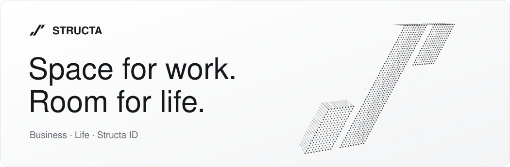

  <picture>
    <source media="(prefers-color-scheme: dark)" srcset="./structa-welcome-dark.svg">
    
  </picture>

  
  
  

# Welcome to Structa

We build software for the work people do together and the things they manage on their own. Structa Business brings everyday operations into a shared workspace. Structa Life gives individuals a place to plan and stay organized. A single Structa ID connects both experiences, with separate access to personal and team spaces.

## What we build

| Product | What it does |
| :--- | :--- |
| **Structa Business** | A shared workspace for small businesses to manage orders, inventory, scheduling, documents, and team access. AI assistance helps teams handle routine work and customer inquiries. [Explore Business](https://www.structainc.com/) · [See plans](https://www.structainc.com/pricing) |
| **Structa Life** | A personal workspace for plans, documents, and everyday tasks. Travel is an early preview for searching flights and planning trips. [Explore Life](https://structalife.com/) |
| **Structa ID** | One account for Business and Life. Your team role governs what you can access at work, and your personal space has its own access. [Learn about Structa ID](https://www.structainc.com/) |

## Follow the work

[Product roadmap](https://www.structainc.com/roadmap) · [Changelog](https://www.structainc.com/changelog) · [Contact Structa](https://www.structainc.com/contact)
